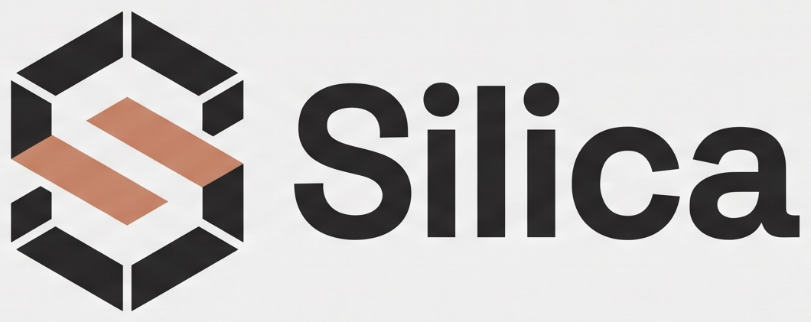

  

  

# Silica

A small, fast-moving programming language with its own syntax, a checked compiler,
a versioned bytecode format, a capability-based security model, a standard library
that includes speech and UI, and a **Script Mode IDE** you run in your browser.

**Latest release: [v0.10.0](https://github.com/sufiyan-sabeel/silica/releases/tag/v0.10.0)** ·
MIT licensed · 671 tests, green on Python 3.9, 3.11 and 3.12

**Website: [sufiyan-sabeel.github.io/silica-website](https://sufiyan-sabeel.github.io/silica-website/)** ·
syntax reference, documentation and the current repository status

PLACEHOLDER_REST_OF_README
