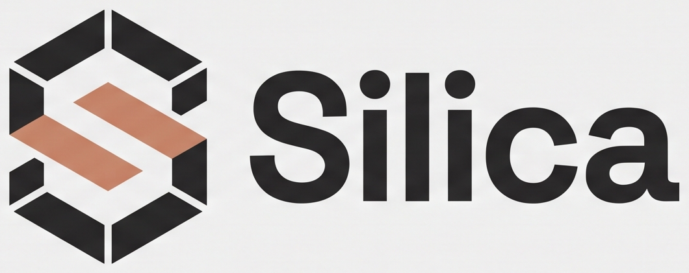

<p align="center">
  
</p>

# Silica

A small, fast-moving programming language with its own syntax, a checked compiler,
a versioned bytecode format, a capability-based security model, a standard library
that includes speech and UI, and a **Script Mode IDE** you run in your browser.

**Latest release: [v0.9.3](https://github.com/sufiyan-sabeel/silica/releases/tag/v0.9.3)** ·
MIT licensed · 671 tests, green on Python 3.9, 3.11 and 3.12

```silica
sfn main() {
    sprint("Hello from Silica")
}
```

```
$ silica run hello.sc
Hello from Silica
```

---

## What Silica is

Silica is a general-purpose language implemented in Python. It has its own
keywords rather than Python's — `sfn` for a function, `sprint` to print, `si`/`sino`
for if/else, `oui`/`nein` for true/false, `tant`/`per` for loops, `ret` to return.

The pipeline is real and checked before anything runs:

```
source .sc → lexer → parser → AST → type checker → bytecode compiler
          → verifier → stack VM
```

`.sbc` bytecode is versioned (format 1.0), verified on load, and never contains raw
host memory structures.

### What it can do today

| Area | Status |
|---|---|
| Language | functions, `let`/`const`, `si`/`sino`, `tant`/`per` with `break`/`continue`, lists, maps, strings (four delimiter forms), Int/Float/Bool |
| Types | static checking with inference for locals; `Int` wraps at 64 bits |
| Bytecode | compile to `.sbc`, versioned and verified, malformed input rejected |
| Optimizer | constant folding at compile time (`SILICA_NO_OPT=1` disables it) |
| Standard library | 23 namespaces: `core`, `math`, `string`, `collections`, `json`, `fs`, `ui`, `tui`, `gui`, `speech` and their submodules |
| Security | capability-based, deny-by-default: `fs.read`, `fs.write`, `fs.list`, `speech.speak`, `speech.listen`, `tui.run`, `gui.run` |
| Tools | `run`, `check`, `compile`, `fmt`, `test`, `repl`, `capabilities`, `voice`, **`ide`** |
| UIs | web UI DSL, terminal UI (curses), desktop windows (tkinter), Script Mode IDE |

### What it cannot do yet

Honest list, so nobody is surprised: **no closures or first-class functions**, no
generics, no structs or enums, no pattern matching, no `Result`/error type, no
package manager (`new`, `add`, `install`, `build` are not implemented and say so),
no language server, no debugger, no concurrency, no `net`/`http`/`crypto`.

Silica is also **not fast**: on the four benchmarks in `benchmarks/bench.py` it
ran **38–101× slower than CPython** when measured on 2026-10-28 (Linux x86_64,
CPython 3.12.13, Silica 0.9.3, best of 3 runs), because the VM is a Python loop.
The ratio moves with the machine and with CPython's own version, so re-run the
script before quoting a figure; `docs/PERFORMANCE.md` and `docs/AUDIT.md` record
the runs and the plan. One measured improvement has landed — constant folding cut
a hot loop by 39% — and `benchmarks/optimizer.py` reproduces it.

---

## Structs

Named records with typed fields, checked before the program runs.

```silica
struct Point {
    x: Int
    y: Int
}

sfn main() {
    let p = Point(x: 3, y: 4)
    sprint(p.x)          # 3
    sprint(p)            # Point(x: 3, y: 4)
}
```

Missing fields, unknown fields and wrong types are compile errors that name the
field and list the real ones. A `const` struct is frozen, even through an alias.
`docs/LANGUAGE_SPEC.md` has the full rules, including what is deliberately absent
(generics, methods).

## Colour

A perceptual colour system in the standard library — OKLab and OKLCH, gamut
mapping instead of clipping, generated palettes, semantic themes and WCAG checks.
No dependencies.

```silica
use colors

sfn main() {
    let brand = colors.oklch(0.65, 0.18, 190)
    let theme = colors.theme(brand)

    sprint(colors.hex(theme["accent"]))
    sprint(str(colors.audit(theme)["passes"]))   # oui
}
```

`colors.oklch(0.65, 0.18, 190)` asks for a teal sRGB cannot display, so it comes
back at chroma 0.112 — same lightness, same hue, the closest colour that fits,
rather than a silently clipped one. Mixing red and blue gives `#8c53a2`, not the
muddy `#7f007f` sRGB produces.

`docs/COLOR.md` has the reference values, the gamut algorithm, and what is
deliberately absent (HDR, APCA).

## Script Mode IDE

`silica ide` starts a local editor and runner for `.sc` files. It opens in your
browser, and the **Run** button executes the real toolchain.

### Launch

```bash
silica ide                    # edit the current directory
silica ide --root ~/scripts   # or a specific workspace
```

It prints its URL and listens on `127.0.0.1`:

```
Silica Script Mode

  workspace : /home/you/scripts
  listening : 127.0.0.1:8080
  open      : http://127.0.0.1:8080/?token=<session-token>

Press Ctrl+C to stop.
```

Open that URL — the token in it is required. Options: `--port N`, `--host H`,
`--no-open`, `--root DIR`.

### Create, open, edit, save, run

1. **Create** — the `+` button in the Scripts panel, or `Ctrl+N`. Name it `hello.sc`.
2. **Open** — click any `.sc` file in the list. Each opens in a tab.
3. **Edit** — the editor has line numbers, syntax highlighting and Tab-to-indent.
   Unsaved files show a dot.
4. **Save** — `Ctrl+S` (or `Cmd+S`). Run saves first, so you never run a stale file.
5. **Run** — the **Run** button or `Ctrl+Enter`. Output, errors and the exit code
   appear in the panel below.

### What the IDE actually does

Verified by `tests/test_ide.py`:

* lists, opens, edits and saves `.sc` files
* runs the current script through `python -m silica run <file>` — a real
  subprocess, no shell — and shows its real stdout, stderr and exit code
* parses `file.sc:12:4: parse error: …` into clickable problems that jump the
  cursor to the line
* stops a running script
* highlights syntax using the compiler's own keyword and type tables
* confines every path to the workspace; `..` and absolute paths are refused

**Not in the IDE yet:** search and replace, code folding, autocomplete. There is
no screenshot in this README because no browser was available to capture one —
the front end is verified structurally and by hand, not visually.

---

## Install

Requires **Python 3.9 or newer**. No third-party packages for the core language.

```bash
curl -fsSL https://raw.githubusercontent.com/sufiyan-sabeel/silica/main/install.sh | sh
```

The installer downloads the release wheel, **verifies its SHA-256 checksum**, and
installs into an isolated environment at `~/.local/share/silica/venv` with a
launcher in `~/.local/bin` (or `$PREFIX/bin` on Termux). No `sudo` unless you set
`SILICA_SYSTEM=1`.

```bash
SILICA_VERSION=0.9.3 sh install.sh   # upgrade or pin to a version
SILICA_VERSION=0.8.0 sh install.sh   # roll back
sh uninstall.sh                      # remove only what it installed
```

### The package

Silica is a Python package: distribution name **`silica-lang`**, import name
`silica`, version `0.9.3`, Python **3.9+**, and **no runtime dependencies** — the
language, CLI, standard library, TUI and IDE are pure standard library.

It is distributed as **versioned GitHub Release assets** (wheel, sdist,
`SHA256SUMS.txt`). It is *not* on GitHub Packages, because GitHub Packages has no
Python registry — its registries are npm, RubyGems, Maven, Gradle, NuGet and
containers. Nothing here is published to a package registry, and this README does
not claim otherwise.

```bash
pip install dist/silica_lang-0.9.3-py3-none-any.whl   # a downloaded asset
silica --version                                       # -> silica 0.9.3
```

See [`docs/PACKAGING.md`](docs/PACKAGING.md) for the wheel contents, the release
pipeline and the Dependabot setup, and
[`docs/SUPPLY_CHAIN.md`](docs/SUPPLY_CHAIN.md) for what security controls are
actually in place — and which ones are still only planned.

From a checkout instead:

```bash
git clone https://github.com/sufiyan-sabeel/silica
cd silica
python3 -m silica --version
```

Optional extras, only needed for the features that use them:

| Feature | Needs |
|---|---|
| Desktop windows (`use gui`) | tkinter — `sudo apt install python3-tk` |
| Speech (`use speech`) | `pip install numpy onnxruntime` plus a Piper voice and a Whisper model |
| Terminal UI (`use tui`) | nothing — `curses` ships with Python |

---

## Command line

```
silica <file.sc|file.sbc>       run a source file or bytecode directly
silica                          start the interactive interpreter
silica run <file.sc|file.sbc>   compile if needed, then execute
silica check <file.sc>          parse and type-check only
silica compile <file.sc> [-o out.sbc]
                                compile to versioned bytecode
silica repl                     interactive session
silica fmt <file.sc> [--check]  rewrite in canonical style
silica test [dir]               run *_test.sc files under dir
silica ide [--root DIR] [--port N] [--host H]
                                Script Mode IDE in your browser
silica voice <subcommand>       speech: list, install, speak, transcribe
silica capabilities [flags]     print the effective capability set
silica --version                print the version
```

### Capabilities

Nothing is granted by default. A program that touches the filesystem without a
grant fails with a located error rather than silently succeeding.

```bash
silica run app.sc --allow-fs-read ./data --allow-fs-write ./out
silica run app.sc --allow-tui          # terminal apps
silica run app.sc --allow-gui          # desktop windows
```

Grants can also live in a `silica.toml` `[capabilities]` table; `--deny-*` removes
one, and a denial always wins.

---

## Examples

Working files live in [`examples/`](examples/). A few:

```bash
silica run examples/hello.sc          # hello world
silica run examples/loops.sc          # loops
silica run examples/conditionals.sc   # si / sino
silica run examples/collections.sc    # lists and maps
silica run examples/fibonacci.sc      # recursion
silica run examples/json_demo.sc      # the json module
silica run examples/calculator.sc     # reads stdin
silica run examples/tui_demo.sc --allow-tui
silica run examples/gui_demo.sc --allow-gui
```

Every example above was run against this build; the ones needing stdin, a
capability or a display are marked as such.

---

## Build and test

```bash
python3 -m unittest discover -s tests -t .   # the full suite
python3 -m pytest -q                          # same, if pytest is installed
python3 -m silica test tests                  # Silica's own test runner
python3 benchmarks/bench.py                   # vs CPython
python3 benchmarks/optimizer.py               # constant folding, measured
```

Current state: **671 tests**, 664 passing and 7 skipped when no display or speech
engine is present, green on Python 3.9 / 3.11 / 3.12.

To build a release locally:

```bash
python3 -m build          # wheel + sdist in dist/
```

---

## Troubleshooting

| Symptom | Cause and fix |
|---|---|
| `capability error: 'fs.read' is not granted` | by design — add `--allow-fs-read DIR` |
| `gui.show: no DISPLAY` | a window needs a display server; on a headless box use `xvfb-run -a …` |
| `tkinter is present but cannot load its Tk libraries` | `sudo apt install python3-tk libtk8.6` |
| `silica ide` says `No module named silica` | you are running from a checkout without `PYTHONPATH`; use `python3 -m silica ide` |
| `silica voice` fails with `mkl_malloc` | set `CT2_USE_MKL=0` |
| `parse error: 'x' is a reserved Silica keyword` | e.g. `input`; rename the identifier |

---

## Platforms

| Platform | Status |
|---|---|
| Linux x86_64 (Debian/Ubuntu) | **Tested** — the full suite and the IDE were run here |
| Termux (Android) | Code paths exist and the installer detects Termux; **not run** on a device |
| Alpine, macOS, Windows | Pure Python, no compiled parts, so it should work; **not tested** |
| iOS | Browser IDE only, pointed at a runner on another machine; **not tested** |

Only the first row is evidence. The others are expectations.

---

## Project layout

```
silica/            lexer, parser, checker, compiler, verifier, VM, CLI
silica/optimizer.py  compile-time constant folding
silica/voice/      Piper TTS, Whisper STT, speech natives
silica/ui/         web UI DSL and HTML renderer
silica/tui/        terminal UI: layout engine + curses driver
silica/gui/        desktop windows on tkinter
silica/ide/        Script Mode IDE: workspace, runner, HTTP API, editor page
tests/             671 tests
examples/          runnable .sc programs
docs/              language spec, bytecode, security, audit, IDE, UI, voice,
                   packaging, supply chain
benchmarks/        benchmarks against CPython
```

Documentation worth reading: [`docs/AUDIT.md`](docs/AUDIT.md) (measured state and
roadmap), [`docs/IDE.md`](docs/IDE.md), [`docs/LANGUAGE_SPEC.md`](docs/LANGUAGE_SPEC.md),
[`docs/BYTECODE.md`](docs/BYTECODE.md), [`SECURITY.md`](SECURITY.md),
[`CHANGELOG.md`](CHANGELOG.md).

---

## Contributing

Issues and pull requests are welcome. Before sending one:

```bash
python3 -m unittest discover -s tests -t .   # must stay green
python3 -m silica fmt --check examples/*.sc  # formatting must be canonical
```

Please keep the honesty rule: if something is not implemented or not tested on a
platform, say so in the docs rather than describing it as working.

Dependabot opens weekly pull requests for GitHub Actions and for the development
dependencies. They are merged only with CI green; the review checklist is in
[`docs/PACKAGING.md`](docs/PACKAGING.md).

---

## Releases

- [v0.9.3](https://github.com/sufiyan-sabeel/silica/releases/tag/v0.9.3) — loop control: `break` and `continue`
- [v0.8.0](https://github.com/sufiyan-sabeel/silica/releases/tag/v0.8.0) — Script Mode IDE
- [v0.7.0](https://github.com/sufiyan-sabeel/silica/releases/tag/v0.7.0) — constant folding optimizer
- [v0.6.0](https://github.com/sufiyan-sabeel/silica/releases/tag/v0.6.0) — desktop GUI
- [v0.5.0](https://github.com/sufiyan-sabeel/silica/releases/tag/v0.5.0) — terminal UI
- [v0.4.0](https://github.com/sufiyan-sabeel/silica/releases/tag/v0.4.0) — speech
- [v0.3.0](https://github.com/sufiyan-sabeel/silica/releases/tag/v0.3.0) — global installer
- [v0.2.1](https://github.com/sufiyan-sabeel/silica/releases/tag/v0.2.1) — logo and editor assets
- [v0.1.0](https://github.com/sufiyan-sabeel/silica/releases/tag/v0.1.0) — first release

Each release ships a wheel, an sdist and `SHA256SUMS.txt`. See
[`CHANGELOG.md`](CHANGELOG.md) for what changed.

---

## License

MIT. Copyright (c) 2026 Umaiz Sufiyan. See [`LICENSE`](LICENSE).
